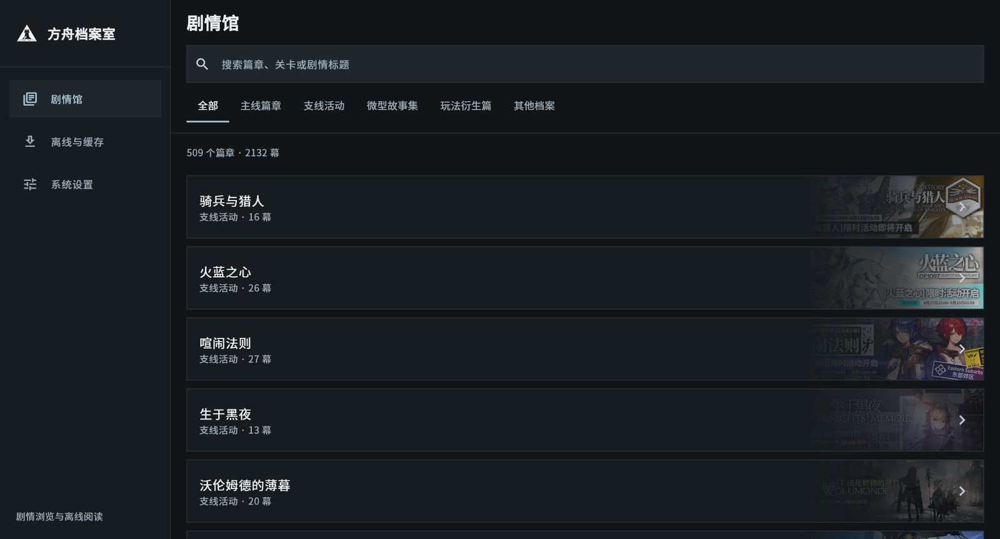
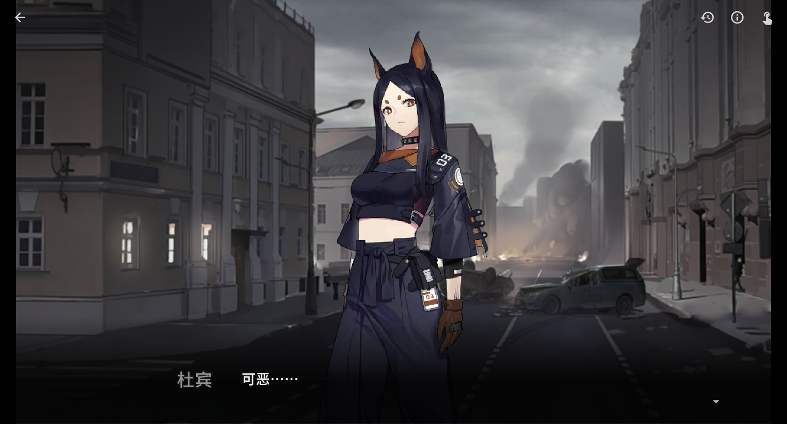
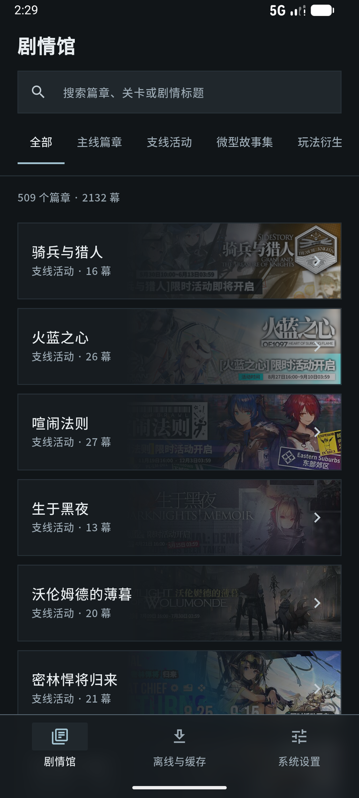
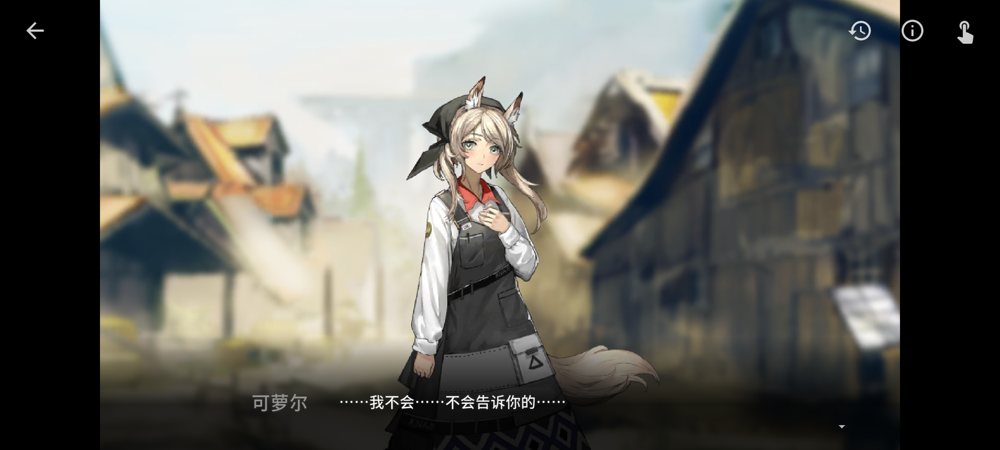

# 方舟档案室

**ArkArchive**

一款用于浏览和播放《明日方舟》剧情的非官方同人应用。

[下载应用](https://github.com/horizonzzzz/ArkArchive/releases) · [反馈问题](https://github.com/horizonzzzz/ArkArchive/issues)

## 应用截图

以下为 Windows 客户端与 Android 移动端的界面预览。

  
  

  Windows 客户端 · 剧情馆 / 剧情播放

  

  Android 移动端 · 剧情馆

  

  Android 移动端 · 剧情播放

## 功能特性

- **剧情分类与检索**：收录主线章节、活动、故事集、插曲及别传等剧情篇章，支持按分类浏览与全局关键词搜索，快速定位篇章、关卡代号和剧情标题；移动端支持滑动切页。
- **人物档案**：按姓名、代号或英文名检索干员与剧情角色，查看不同形态的资料、立绘和已识别出场记录；支持职业、阵营、星级筛选，深层资料与台词默认折叠。可从台词节选进入回放，默认不改写原有观看进度。人物文本随应用提供，可离线阅读；图片按需联网缓存。
- **离线缓存**：剧本、图片和音频素材按需异步加载；可在剧情条目菜单中逐条缓存，缓存页支持暂停、恢复或删除任务并显示失败原因；提供移动网络下载提醒、并发下载控制、桌面端自定义缓存目录，以及按剧情查看占用空间和清理缓存。
- **高还原播放器**：还原原作视觉排版与剧场级演出，支持立绘切换、背景变换、部分火焰与烟雾粒子特效、动态遮罩着色器与黑屏转场；支持打字机逐字输出、自由旁白贴纸、倒计时和分支剧情选择；完整播放 BGM、环境音与角色音效，主音量、BGM 与音效可分别调节，并提供自动播放、历史对白回顾和全屏沉浸模式。
- **播放断点记忆**：自动保存每篇未看完剧情的进度，列表显示「继续观看」标识，进入播放器后可选择「从上次继续」，恢复到上次对白或选项；清理离线资源不会清除断点，断点失效时会提示并保留记录，播完后自动清除。
- **播放进度调整与预览**：拖动进度条可预览目标停顿点的背景与立绘，松手后吸附到最近的稳定停顿点并跳转；支持回退到任意已播放位置、长按 2/4/8/16 倍速快进，以及从历史对白记录跳转。

应用原生支持 Android、Windows 与 Linux；设置页可查看版本与开源信息并检查 GitHub 最新发布。更新包在应用内下载，显示进度、速度与剩余时间；GitHub 下载具备完整性校验信息时自动尝试公开加速代理并支持换源，缺少校验信息时直连 GitHub，检测接口受限时改用备用通道。Android 下载完成后可直接安装（首次需「未知来源」授权），Windows 可直接运行安装程序。

## 后续开发计划

- **完善暂时未支持和支持不到位的演出特性**
- **全量剧情文本检索**：在人物出场索引的基础上，继续扩展全文检索与更多索引维度。
- **剧情静态资源选择性下载**：可按剧情选择下载图片、立绘、音乐等静态资源，无需缓存整段剧情。
- **更多 PRTS 档案资源**：支持查看 PRTS 上的其他档案类资源，扩展剧情之外的资料浏览。

## 下载与安装

前往 [GitHub Releases](https://github.com/horizonzzzz/ArkArchive/releases) 下载适合您设备的最新安装包（文件名已包含对应版本号）：

- **Android**：提供通用版及主流架构（ARM64、ARM32、x86_64）的 APK 安装包。
- **Windows (x64)**：提供快速安装包（Setup）与免安装便携包（Zip）。
- **Linux (x64 / ARM64)**：提供 DEB 安装包、开箱即用的 AppImage 以及独立 tar.gz 压缩包。

## 版本与兼容性

Android Release 从签名变更后的版本起使用固定密钥签名，可以直接覆盖安装；从更早的版本升级到该版本仍需卸载一次，本地缓存和观看断点会随之丢失。Windows 安装包未配置代码签名，系统可能显示安全提示。正式安装前请备份本地数据，并从本项目的 GitHub Releases 下载文件。

## 鸣谢与声明

- [PRTS](https://prts.wiki/)：提供剧情索引及相关数据资源；本项目的剧情播放器演出与交互逻辑参考了 PRTS 的播放器实现，特此致谢。
- [鹰角网络](https://www.hypergryph.com/)：创作《明日方舟》及其游戏内容。
- [Linux.do](https://linux.do/)：感谢 LINUX DO 社区提供开放、友善的技术交流平台。

本项目为非官方同人项目，与鹰角网络无从属或合作关系。《明日方舟》及其剧情、角色、图像、音乐等游戏资源的版权归鹰角网络所有。

## 许可证

本项目代码采用 [MIT License](LICENSE) 开源。游戏资源及其他第三方资源不属于该许可范围，其权利与使用条款由各自权利人决定。
